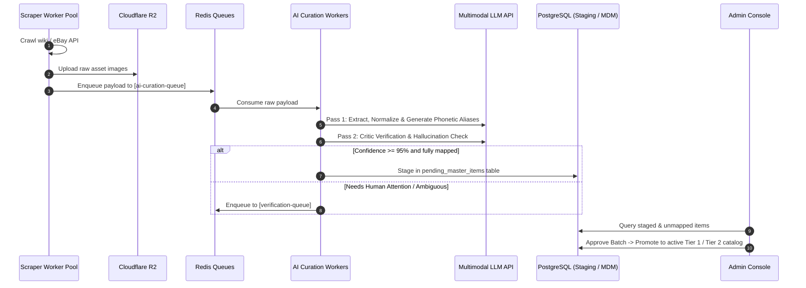
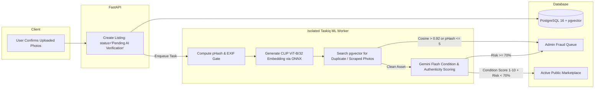
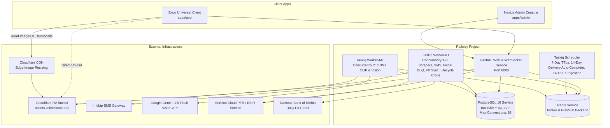

# Architecture Spine — Kolekcionar.app

## Design Paradigm

The system follows a **Modular Monolith with Asynchronous Task Workers (Pipes-and-Filters)**. The core transactional domain (Master Data Management, User Collections, Listings, Reservations, Billing & Fiscalization, Order Messaging) resides in an async FastAPI service communicating with PostgreSQL 16. Long-running, high-latency, or external tasks (Web Scraping, AI Normalization & Verification, Image Deduplication, Order Lifecycle Timers, Daily FX Rate Ingestion, and Fiscalization DLQ Synchronization) execute in isolated worker processes orchestrated over Redis queues via Taskiq. The client tier uses a **Universal Cross-Platform Client Architecture (Expo / React Native)** sharing code across Web, iOS, and Android, paired with a dedicated Admin Web application in a Turborepo monorepo.

```mermaid
graph TD
    subgraph Client Tier [Turborepo Client Tier]
        App[Universal App: Expo / React Native<br/>iOS / Android / Web Browser<br/>REST + WebSocket Client]
        AdminApp[Admin Back-Office: Next.js Web<br/>Desktop / Operator Console]
    end

    subgraph Edge & Storage [Edge & Object Storage]
        CF_R2[Cloudflare R2 Object Storage<br/>Two-Phase Pre-signed Direct Uploads]
        CF_CDN[Cloudflare Global Edge CDN<br/>On-The-Fly WebP Image Resizing]
    end

    subgraph Railway Compute [Railway Platform Hosting]
        API[FastAPI Async Backend<br/>REST API + WebSocket Gateway]
        Redis[(Managed Redis Broker & Pub/Sub<br/>Task Queues + Real-Time Chat)]
        
        subgraph Worker Topology [Isolated Taskiq Workers]
            WorkerIO[Worker-IO: Lightweight Queue<br/>Scrapers / SMS / Fiscal DLQ / Crons]
            WorkerML[Worker-ML: Heavy Inference Queue<br/>ONNX CLIP / pHash / Gemini Vision]
        end
        
        DB[(Managed PostgreSQL 16<br/>pgvector + pg_trgm + JSONB<br/>Max Connections Budgeted: 86/100)]
    end

    subgraph External Services
        LLM[Google Gemini 1.5 Flash Vision API<br/>Condition & Authenticity]
        SMS[Infobip SMS Gateway<br/>+381 Mobile OTP Verification]
        Fiscal[Serbian Cloud e-Fiscalization Service<br/>Cloud ESIR / PFR REST API]
        NBS_IPS[NBS IPS QR & Transfer Engine<br/>Direct Payment Instructions]
        NBS_FX[NBS Exchange Rate Daily Feed<br/>14:15 CET Banking Ingestion]
        TargetWeb[Target Wikis & APIs<br/>Hot Wheels Fandom, Pokémon, eBay]
    end

    App -->|HTTPS REST & WSS| API
    AdminApp -->|HTTPS REST| API
    App -->|1. Pre-signed PUT| CF_R2
    App -->|2. Confirm Upload| API
    App -->|GET Optimized Images / Thumbnails| CF_CDN
    CF_CDN --> CF_R2

    API -->|Read / Write| DB
    API -->|Dispatch Jobs & Pub/Sub| Redis
    API -->|Send OTP| SMS
    API -->|Generate IPS QR / Instructions| NBS_IPS
    API -->|Issue Fiscal Receipt on Approval| Fiscal

    WorkerIO -->|Pop Jobs| Redis
    WorkerIO -->|Scrape| TargetWeb
    WorkerIO -->|Daily Rate Ingestion| NBS_FX
    WorkerIO -->|Retry SUF Sync| Fiscal
    WorkerIO -->|Read / Write Staged Data| DB

    WorkerML -->|Pop Heavy Jobs| Redis
    WorkerML -->|Read Uploaded Images| CF_R2
    WorkerML -->|Compute Embeddings & Vector Search| DB
    WorkerML -->|Vision Scoring| LLM
```



## Invariants & Rules

### AD-1 — Async FastAPI Modular Domain Boundary [ADOPTED]
- **Binds:** `all` backend services, API routes, data models.
- **Prevents:** Spaghetti dependencies, cross-domain coupling, and technical-layer scattering.
- **Rule:** The backend must be structured strictly as async domain modules (`app/modules/<domain>/` encompassing `auth`, `mdm`, `collection`, `marketplace`, `billing`, `messaging`, `berze`). Each domain module encapsulates its own routes, SQLAlchemy models, Pydantic schemas, and domain service logic. Inter-module communication must occur exclusively via explicit service interfaces, never by reaching into another domain's private models or database tables. All database interactions must use non-blocking asynchronous drivers (`asyncpg` with SQLAlchemy 2.0 AsyncSession). Synchronous blocking network calls or disk operations inside request handlers are strictly prohibited; blocking operations must be offloaded to `anyio.to_thread.run_sync` or Taskiq worker queues.

### AD-2 — 3-Tier MDM Strict Hierarchical Integrity [ADOPTED]
- **Binds:** `CAP-MDM-CATALOG`, `CAP-PORTFOLIO-TRACKER`, database schema.
- **Prevents:** Corrupted catalog normalization, fragmented naming variations, and mixing public catalog entities with private user lot metadata.
- **Rule:** Catalog entities must strictly adhere to the 3-Tier model:
  1. **Tier 1 (Master Item)**: Canonical base design (English name, debut year, manufacturer, brand, sub-brand).
  2. **Tier 2 (Variant)**: Commercial release (series, tampo/deco, wheel type, card finish, release year, official reference image).
  3. **Tier 3 (User Lot Instance)**: Collector inventory item linking to a Tier 2 Variant, holding private financial attributes (acquisition price, currency, NBS exchange rate, date, storage location).
  A User Lot Instance must never reference a Tier 1 Master Item directly without binding to a Tier 2 Variant.

### AD-3 — Three-Queue Asynchronous Ingestion & Two-Pass AI Pipeline [ADOPTED]
- **Binds:** `CAP-SCRAPING-INGESTION`, `CAP-AI-CURATION-FRAUD`, Admin Console.
- **Prevents:** Scraper failure crashing the API, unverified LLM hallucinations polluting the production catalog, and worker backlog collisions.
- **Rule:** Data scraping and ingestion must traverse three sequential, decoupled Redis queues:
  1. `scraping-queue`: Scraper pool fetches raw HTML/JSON and downloads raw image assets to Cloudflare R2.
  2. `ai-curation-queue`: Raw payloads are processed via a two-pass AI pipeline: **Pass 1 (Ingestion Agent)** parses and maps attributes to the 3-tier MDM schema and pre-computes phonetic search aliases (AD-13); **Pass 2 (Verification Critic Agent)** validates schema consistency, detects contradictions, and scores extraction confidence.
  3. `verification-queue`: Data scoring below 95% confidence or containing unmapped attributes must be routed to the Admin Verification Queue. Direct write into production Tier 1/Tier 2 tables by automated scrapers is prohibited without human admin approval or automated pass thresholds.



### AD-4 — Image Storage Zero-Egress, Two-Phase Handshake & Edge Resizing [ADOPTED]
- **Binds:** `CAP-MARKETPLACE-RESERVATION`, `CAP-SCRAPING-INGESTION`, mobile/web clients.
- **Prevents:** Backend web container memory exhaustion during image uploads, vendor egress lock-in, unconstrained storage bomb attacks, and mobile bandwidth choking.
- **Rule:** All image assets (listing photos, user collection pictures, catalog reference images) must be stored in Cloudflare R2 (S3-compatible API) and served through Cloudflare CDN:
  1. **Phase 1 (Pre-sign Request)**: The client calls `POST /api/v1/photos/presign` specifying MIME type and intended usage. The API issues a short-lived (300s TTL) pre-signed S3 `PUT` URL with strict signed policy constraints: `content-length-range` enforcing maximum 10MB file size, and restricted MIME headers (`image/jpeg`, `image/png`, `image/webp`).
  2. **Client Direct Upload**: The client streams the image directly from device memory/disk to Cloudflare R2.
  3. **Phase 2 (Confirmation Handshake)**: Upon successful upload, the client calls `POST /api/v1/photos/confirm` with the assigned image UUID. The FastAPI backend executes a lightweight `HeadObject` check against R2 verifying exact object presence, Content-Type, and size before persisting the database record and enqueuing the asset to the `ai-curation-queue` or `anti-fraud-queue`. Images must be referenced exclusively by their UUID-keyed object paths.
  4. **Cloudflare Edge Image Resizing**: All client-facing image URLs (thumbnails, detail views, responsive variants) must be served through Cloudflare CDN Edge Image Resizing (`https://assets.kolekcionar.app/cdn-cgi/image/width={width},format=webp,quality=80/{image_uuid}.webp`). Worker processes must never perform synchronous thumbnail downscaling, and no thumbnail duplicates are stored in R2.

### AD-5 — Atomic Marketplace Multi-Quantity Reservation & Lifecycle Maintenance [ADOPTED]
- **Binds:** `CAP-MARKETPLACE-RESERVATION`, listings, orders.
- **Prevents:** Double-reservation race conditions, inventory corruption on multi-quantity items, zombie order lockup, and abandoned transactions.
- **Rule:** Reservation of a marketplace listing must be atomic via database row-level conditional decrement supporting both single-unit and multi-quantity inventory (`quantity >= 1`):
  ```sql
  UPDATE listings
  SET quantity = quantity - :requested_qty,
      status = CASE WHEN quantity - :requested_qty = 0 THEN 'Reserved' ELSE 'Active' END,
      updated_at = NOW()
  WHERE id = :id
    AND status = 'Active'
    AND quantity >= :requested_qty
  RETURNING id, quantity, status;
  ```
  If zero rows are returned, the reservation fails immediately with `409 Conflict` (insufficient quantity or listing already committed). Every successful reservation creates an `order` record with an expiration timestamp (`expires_at = NOW() + INTERVAL '7 days'`).
  
  The order lifecycle is actively governed by scheduled Taskiq maintenance crons and manual fulfillment tracking:
  1. **7-Day Anti-Zombie Cron (Every 15 min)**: Expired unconfirmed reservations (`created_at < NOW() - INTERVAL '7 days'`) automatically transition to `CancelledBySystem`. The reserved quantity is restored to the parent listing's stock via atomic increment, and listing status resets to `Active` (or `Paused` if the seller's subscription has lapsed).
  2. **Courier Fulfillment Tracking (Phase 1 & 2 Manual Reference Entry)**: External automated courier API and scraper integration is deferred. Sellers and the platform owner manually input authentic courier tracking numbers (e.g. Post Express, D Express, Bex `PE...RS`) upon parcel handover, transitioning the order to `InTransit`. Delivery is acknowledged via mutual user confirmation or single-party dispute flagging.
  3. **14-Day Delivery Auto-Completion Cron (Daily)**: Orders remaining in `InTransit` for 14 calendar days without open disputes or courier return flags automatically advance to `Completed`, releasing positive rating unlocks.

### AD-6 — Universal Frontend Monorepo via Expo & Next.js [ADOPTED]
- **Binds:** `all` client applications, UI packages.
- **Prevents:** Code duplication across iOS, Android, and Web, diverging business logic, and multiple incompatible API client implementations.
- **Rule:** The frontend must reside in a single Turborepo workspace:
  - `apps/app`: Universal client built with Expo SDK 52 (Expo Router v4), rendering native iOS & Android binaries and responsive Web (React Native Web).
  - `apps/admin`: Admin Console built with Next.js / Vite React, optimized for desktop multi-window back-office operations.
  - `packages/api-client`: Auto-generated TypeScript fetch and WebSocket client generated from the FastAPI backend's OpenAPI JSON (`openapi.json`).
  The mobile/web apps must never define manual ad-hoc fetch signatures; all requests must flow through the shared typed client.

### AD-7 — Anti-Fraud Pipeline: Perceptual Hashing & Visual Embeddings with Memory Isolation [ADOPTED]
- **Binds:** `CAP-AI-CURATION-FRAUD`, listing creation.
- **Prevents:** Stolen photo reposting, stock photo scam listings, counterfeit item dissemination, and worker container out-of-memory crashes.
- **Rule:** When a seller creates a listing with photos:
  1. The listing is created optimistically with status `Pending AI Verification` (SLA < 60s).
  2. A dedicated `Worker-ML` background job evaluates the images in two stages:
     - **Stage 1 (Immediate CPU Gate, < 2s)**: Computes 64-bit perceptual hash (`dhash` / `phash` via `imagehash`) and inspects EXIF metadata. If Hamming distance against catalog stock images or scraped assets is `<= 5`, the upload is flagged as a duplicate. Missing EXIF (messaging compression via Viber/WhatsApp) is treated as neutral; only contradictory synthetic EXIF escalates risk.
     - **Stage 2 (Visual Embedding & Condition Gate, < 60s)**: Generates a 512-dimensional visual vector using `CLIP ViT-B/32` via ONNX Runtime. If cosine similarity against existing catalog or listing embeddings in `pgvector` exceeds `0.92`, the listing is flagged as an unauthorized stock image. Thresholds must be injected via environment configuration (`settings.FRAUD_PHASH_HAMMING_THRESHOLD`, `settings.FRAUD_CLIP_COSINE_THRESHOLD`).
  3. **Memory Isolation Invariant**: The ONNX Runtime inference session must be loaded as a process singleton inside the dedicated `Worker-ML` queue, with CPU intra-operator threads bounded (`intra_op_num_threads=2`). Worker concurrency on the ML container is strictly capped to 2 processes to ensure total container memory consumption remains under 1.5GB RAM on Railway.
  4. Listings scoring below 70% counterfeit risk transition automatically to `Active` with an attached non-binding **AI Advisory Badge** (condition score 1–10 + defect summary). Listings scoring `>= 70%` risk transition to `Pending Admin Review` and route to the `/admin` Fraud Queue.



### AD-8 — Serbian Commerce Law Compliance & PII Isolation [ADOPTED]
- **Binds:** `CAP-MARKETPLACE-RESERVATION`, user profiles, order messaging.
- **Prevents:** Illegal commission-taking under Serbian Commerce Law (*Zakon o trgovini*) and premature privacy leaks between traders.
- **Rule:** In Phase 2, the platform operates strictly as a classified listing facilitator funded by recurring seller subscription fees (`Starter`, `Collector Pro`, `Dealer Power`); the platform must NEVER take transaction commissions or hold escrow funds. In the order workflow, buyer full name, phone number, and delivery address must remain masked until the seller clicks "Confirm Order". Once confirmed, shipping details are revealed solely for direct courier cash-on-delivery (*pouzećem*) fulfillment.

### AD-9 — Cloud e-Fiscalization & NBS IPS Direct Reconciliation [ADOPTED]
- **Binds:** `CAP-BILLING-FISCALIZATION`, subscriptions, retail checkout.
- **Prevents:** Statutory non-compliance with the Serbian *Zakon o fiskalizaciji*, illegal untracked revenue, and unnecessary merchant acquiring banking overhead prior to product-market fit.
- **Rule:** The platform adopts **Option A: Cloud ESIR / PFR REST API** (e.g. Teron, Sky e-fiskalizacija, or Moj e-Račun) for all statutory fiscal invoice generation:
  1. **Phase 1 Retail Fiscalization**: In Phase 1, platform owner retail sales dispatched via courier cash-on-delivery (*pouzećem*) generate fiscal receipts via the Cloud PFR API upon parcel dispatch.
  2. **Phase 2 Seller Subscriptions (NBS IPS Direct & Reconciliation)**: Card payment processing (ChipCard/NestPay) is deferred. Phase 2 monthly seller subscriptions are initiated by generating an NBS IPS QR code (`K:PR|V:01|...`) and payment slip instructions carrying a deterministic payment reference: `KOLEK-<USER_ID>-<MONTH>`. Subscriptions enter status `PendingPaymentVerification`. The platform administrator reconciles received bank transfers via the Admin Console (`/admin/fiscal`), where single-click approval calls the Cloud PFR API to issue the statutory fiscal receipt, emails the PDF to the seller, and unlocks the listing tier quota.
  3. **Offline Resilience & DLQ**: If the Cloud PFR service or Ministry of Finance SUF portal times out (> 3.0s) or returns HTTP 5xx, the transaction capture is not aborted. The system creates a pending fiscal record, enqueues the payload to `fiscal-sync-queue` (Taskiq), and retries synchronization with exponential backoff within the statutory 5-day window.

### AD-10 — Real-Time Order Messaging & Phased Disclosure Gateway [ADOPTED]
- **Binds:** `CAP-ORDER-MESSAGING`, `CAP-MARKETPLACE-RESERVATION`.
- **Prevents:** Insecure PII leakage in chat, out-of-band communication disputes, and unauthenticated messaging streams.
- **Rule:** Reserving an item atomically initializes a dedicated platform order message thread between buyer and seller:
  1. **Transport & Broker**: Real-time communication terminates at an async WebSocket gateway (`/ws/v1/orders/{order_id}`) hosted on FastAPI, backed by Redis Pub/Sub channels (`order_channel:{order_id}`) allowing seamless multi-instance message broadcast across API containers.
  2. **Handshake Security**: WebSocket connection authentication must not pass JWT tokens in query parameters (preventing token leakage to proxy/ingress access logs). Clients must request a short-lived (60s TTL), single-use connection ticket via authenticated REST (`POST /api/v1/orders/{id}/ws-ticket`) and present it during the WebSocket protocol upgrade.
  3. **Phased PII Isolation Invariant**: The backend WebSocket and REST endpoints must enforce server-side data masking on buyer contact details (`+381 64 *** **12`) while `confirmed_by_seller = false`. Only after the seller triggers `POST /api/v1/orders/{id}/confirm` are full shipping details emitted to the seller's active session.

### AD-11 — Phase 1 Courier COD Showcase vs Phase 2 P2P Marketplace Transition [ADOPTED]
- **Binds:** `CAP-MARKETPLACE-RESERVATION`, `CAP-MDM-CATALOG`, Feature Gating.
- **Prevents:** Premature launch of complex C2C marketplace liabilities before establishing the core catalog showcase, and premature onboarding of merchant payment gateways.
- **Rule:** The platform enforces architectural feature gating via `P2P_MARKETPLACE_ENABLED` (`bool`):
  - **Phase 1 (`P2P_MARKETPLACE_ENABLED=false`)**: The platform operates strictly as the Platform Owner Retail Showcase and Collector Portfolio Tracker. Only Admin accounts can create public listings; standard users have read-only access to the catalog, 100% free lifetime personal collection portfolio tracking, and Berze event viewing. Phase 1 retail fulfillment operates exclusively via courier delivery (Post Express or other couriers) with Cash-on-Delivery (*pouzećem*). Domestic card processing is postponed until the platform reaches sufficient scale.
  - **Phase 2 (`P2P_MARKETPLACE_ENABLED=true`)**: Full P2P multi-seller classified reservation system unlocks. Subscribed sellers create listings, AI fraud detection activates, atomic reservations open to SMS-verified users, and direct COD fulfillment executes under *Zakon o trgovini*.

### AD-12 — Local Relational NBS FX Cache & Deterministic Lookback [ADOPTED]
- **Binds:** `CAP-PORTFOLIO-TRACKER`, `modules/collection`.
- **Prevents:** Runtime HTTP latency spikes, crashes during National Bank of Serbia network outages, and missing weekend rates.
- **Rule:** The platform must maintain a dedicated PostgreSQL table `exchange_rates(currency VARCHAR(3), rate_date DATE, middle_rate NUMERIC(12, 4), created_at TIMESTAMPTZ, PRIMARY KEY (currency, rate_date))` pre-seeded with historical NBS middle exchange rates for EUR and USD from 2000 to the present.
  1. **Scheduled Daily Ingestion**: A scheduled Taskiq cron executes every banking business day at 14:15 CET (immediately following official NBS publication) to insert the day's official rates.
  2. **Pure Local Resolution**: At runtime, `modules/collection` resolves historical conversion costs exclusively via local SQL:
     ```sql
     SELECT middle_rate, rate_date 
     FROM exchange_rates 
     WHERE currency = :currency AND rate_date <= :acquisition_date 
     ORDER BY rate_date DESC 
     LIMIT 1;
     ```
  Synchronous outbound HTTP calls to external NBS endpoints during user item creation are strictly prohibited. The SQL `<=` condition deterministically guarantees statutory Friday rate fallback for acquisitions occurring on weekends or public non-banking holidays without branching logic.

### AD-13 — Cross-Script Phonetic Search & Ingestion Alias Pre-computation [ADOPTED]
- **Binds:** `CAP-MDM-CATALOG`, search service, `modules/mdm`.
- **Prevents:** Search misses when collectors query English collectible names using Serbian Cyrillic phonetics (e.g. `Нисан Скајлајн` vs `Nissan Skyline`).
- **Rule:** During the Two-Pass AI Ingestion Pipeline (AD-3), Pass 1 must generate localized phonetic search aliases for every Tier 1 Master Item:
  1. Serbian Cyrillic phonetic transcription (e.g. `Нисан Скајлајн`).
  2. Serbian Latin phonetic transcription (e.g. `Nisan Skajlajn`).
  3. Popular casting or character community nicknames (e.g. `Godzilla`, `R34`).
  
  These aliases are persisted in a `search_aliases TEXT[]` array column on `master_items`, indexed with a PostgreSQL GIN trigram index (`CREATE INDEX idx_master_items_search ON master_items USING gin (name gin_trgm_ops, search_aliases)`). At query time, the search service normalizes incoming Cyrillic queries to Latin, and evaluates trigram similarity simultaneously against both canonical English names and pre-computed aliases.

### AD-14 — Bounded Database Connection Pool & Railway Budgeting [ADOPTED]
- **Binds:** `all` backend processes, Railway deployment.
- **Prevents:** PostgreSQL client connection exhaustion (`too many clients already`) exceeding Railway's standard 100-connection container ceiling.
- **Rule:** Total database connection pools across all Railway container instances must be strictly budgeted in `core/config.py`:
  - `kolekcionar-api` (4 Uvicorn workers): `pool_size = 5, max_overflow = 5` per worker process (Max 40 connections).
  - `kolekcionar-worker-io` (up to 8 processes): `pool_size = 2, max_overflow = 2` per process (Max 32 connections).
  - `kolekcionar-worker-ml` (2 processes): `pool_size = 2, max_overflow = 0` (Max 4 connections).
  - Next.js Admin & migrations: Max 10 connections.
  The theoretical maximum concurrent connection footprint is capped at 86, preserving a 14-connection safety margin below Railway's 100-connection ceiling without requiring PgBouncer in early phases.

## Consistency Conventions

| Concern | Convention |
| --- | --- |
| Entity Primary Keys | UUIDv7 (`uuid_generate_v7()` or Python `uuid6` / `uuid.uuid7()`) for time-ordered index locality |
| Timestamps | UTC ISO-8601 (`YYYY-MM-DDTHH:MM:SS.ffffffZ`), PostgreSQL `TIMESTAMPTZ` |
| Currencies & Money | Decimal(12, 2) stored with ISO 4217 currency code (`RSD`, `EUR`, `USD`); historical NBS middle rate recorded on transaction date |
| API URL Structure | Kebab-case, plural nouns: `/api/v1/master-items`, `/api/v1/user-lots`, `/api/v1/listings`, `/api/v1/orders`, `/api/v1/billing` |
| Error Envelopes | RFC 7807 Problem Details: `{"type": "string", "title": "string", "status": 400, "detail": "string", "code": "ERR_CODE"}` |
| State Mutations | Explicit PATCH/POST verbs triggering validated state-machine transitions; no raw direct status updates from client |
| Authentication | Bearer JWT (Access Token 15m, Refresh Token 30d in httpOnly cookie / SecureStore) |
| Real-Time Messaging | WebSocket RFC 6455 authenticated via single-use ticket; Redis Pub/Sub broadcast |
| Image Upload Limits | Max 10MB per image, MIME types: `image/jpeg`, `image/png`, `image/webp`; two-phase presign + confirm handshake |
| Image Transformations | Cloudflare CDN Edge Resizing: `/cdn-cgi/image/width={w},format=webp,quality=80/{id}.webp` |
| Fraud Thresholds | Configurable: pHash Hamming distance `<= 5`, CLIP cosine similarity `> 0.92`, risk threshold `0.70` |
| Fiscalization DLQ | Exponential backoff retry (1m, 5m, 30m, 2h, 12h), maximum 5 days statutory limit |
| FX Rate Resolution | Local relational table `exchange_rates` with deterministic `<=` lookback query (zero runtime HTTP calls) |
| Search Aliases | `search_aliases TEXT[]` with GIN trigram index covering Cyrillic and Latin phonetic variations |
| Database Connections | Hard-capped per service tier (`api` = 5+5, `worker-io` = 2+2, `worker-ml` = 2+0; peak = 86/100) |
| Configuration | 12-factor environment variables validated through `pydantic-settings` |
| Logging | Structured JSON logging with `trace_id`, `user_id`, and `duration_ms` |

## Stack

| Name | Version | Role |
| --- | --- | --- |
| Python | 3.12.x | Backend runtime |
| FastAPI | 0.115.x | Async ASGI Web Framework (REST + WebSockets) |
| SQLAlchemy | 2.0.38 | Async ORM & SQL Builder |
| asyncpg | 0.30.0 | Async PostgreSQL driver |
| Alembic | 1.14.x | Database schema migrations |
| Taskiq | 0.11.x | Async Python distributed task queue |
| Redis (Client) | 5.2.x | Redis client for Taskiq broker, caching, and Pub/Sub |
| PostgreSQL | 16.x | Relational primary database |
| pgvector | 0.8.x | PostgreSQL vector extension for CLIP embeddings |
| pg_trgm | 1.6.x | PostgreSQL trigram extension for fuzzy & cross-script search |
| React Native | 0.76.x | Mobile native UI framework |
| Expo SDK | 52.x | Universal app platform (iOS, Android, Web) |
| Expo Router | 4.x | File-based typed routing for universal client |
| Next.js | 15.x | Admin Console web framework |
| Turborepo | 2.x | Monorepo build and workspace orchestrator |
| Cloudflare R2 | S3 API | Zero-egress object storage for photos |
| Cloudflare Images | CDN Edge | On-the-fly WebP image resizing and responsive delivery |
| ONNX Runtime | 1.20.x | Lightweight CPU inference for CLIP ViT-B/32 (Worker-ML) |
| ImageHash | 4.3.x | Perceptual hashing (pHash) library |
| Infobip API | REST v1 | Regional SMS OTP gateway for Serbian mobile numbers (+381) |
| Serbian Cloud PFR | REST v1 | Cloud ESIR/PFR e-fiscalization software API (Teron / Sky / Moj e-Račun) |
| NBS IPS QR Generator | Standard IPS | Domestic NBS Instant Payment System QR code generator for direct account transfers |
| Railway Platform | v2 PaaS | Deployment and container hosting platform |

## Structural Seed

### System Component Diagram



### Monorepo Source Tree

```text
kolekcionar/
├── apps/
│   ├── app/                                # Universal Expo Client (iOS, Android, Web)
│   │   ├── app/                            # Expo Router file-based pages
│   │   │   ├── (tabs)/                     # Main bottom-tabs (Catalog, Portfolio, Market, Berze)
│   │   │   ├── item/[id].tsx               # Master item detail view
│   │   │   ├── listing/[id].tsx            # Marketplace listing & reservation
│   │   │   ├── order/[id].tsx              # Order management & masked PII view
│   │   │   ├── order/[id]/chat.tsx         # Real-time WebSocket order chat
│   │   │   └── _layout.tsx                 # Root navigation layout
│   │   ├── components/                     # Reusable Nativewind UI components
│   │   ├── hooks/                          # Custom React hooks (useOrderChat, useAuth)
│   │   └── package.json
│   └── admin/                              # Admin Console (Next.js 15)
│       ├── src/
│       │   ├── app/                        # Next.js App Router
│       │   │   ├── mdm/                    # 3-tier catalog CRUD & staging approval
│       │   │   ├── scrapers/               # Scraper pool trigger & monitoring
│       │   │   ├── fraud/                  # Flagged image & counterfeit review
│       │   │   ├── fiscal/                 # e-Fiscal audit trail, NBS IPS reconciliation & SUF DLQ
│       │   │   └── disputes/               # Dispute arbitration & feedback redactor
│       │   └── components/                 # Data tables & diff inspectors
│       └── package.json
├── backend/                                # FastAPI Python Application (Domain-First)
│   ├── app/
│   │   ├── core/                           # Cross-cutting concerns
│   │   │   ├── config.py                   # Pydantic v2 settings (fraud thresholds, pool budgets)
│   │   │   ├── database.py                 # Async SQLAlchemy engine with budgeted connection pool
│   │   │   ├── security.py                 # JWT, bcrypt password hashing, phone OTP
│   │   │   ├── storage_r2.py               # Cloudflare R2 S3 pre-signed URL generator
│   │   │   └── websockets.py               # Redis Pub/Sub WebSocket connection manager
│   │   ├── modules/                        # Strict Domain Boundaries (AD-1)
│   │   │   ├── auth/                       # User accounts, JWT, Infobip SMS verification
│   │   │   │   ├── router.py
│   │   │   │   ├── models.py
│   │   │   │   ├── schemas.py
│   │   │   │   └── service.py
│   │   │   ├── mdm/                        # 3-tier Catalog (MasterItem, Variant) & Search Aliases
│   │   │   │   ├── router.py
│   │   │   │   ├── models.py               # Includes search_aliases TEXT[]
│   │   │   │   ├── schemas.py
│   │   │   │   └── service.py              # Cross-script Cyrillic/Latin search engine
│   │   │   ├── collection/                 # Tier 3 User Lots, Portfolio, Local NBS FX cache
│   │   │   │   ├── router.py
│   │   │   │   ├── models.py               # UserLot, ExchangeRate (AD-12)
│   │   │   │   ├── schemas.py
│   │   │   │   └── service.py              # Deterministic NBS FX lookback calculator
│   │   │   ├── marketplace/                # Listings, Atomic Reservations, Orders, COD
│   │   │   │   ├── router.py
│   │   │   │   ├── models.py
│   │   │   │   ├── schemas.py
│   │   │   │   └── service.py
│   │   │   ├── billing/                    # Subscriptions, NBS IPS QR generator, Cloud e-Fiscalization
│   │   │   │   ├── router.py
│   │   │   │   ├── models.py               # Subscription with PendingPaymentVerification state
│   │   │   │   ├── schemas.py
│   │   │   │   └── fiscal_service.py       # Cloud PFR REST client + DLQ dispatcher
│   │   │   ├── messaging/                  # Order chat WebSocket & Phased PII disclosure
│   │   │   │   ├── router.py
│   │   │   │   ├── models.py
│   │   │   │   ├── schemas.py
│   │   │   │   └── service.py
│   │   │   └── berze/                      # Community meetups notice board & RSVPs
│   │   │       ├── router.py
│   │   │       ├── models.py
│   │   │       ├── schemas.py
│   │   │       └── service.py
│   │   ├── workers/                        # Taskiq Asynchronous Workers
│   │   │   ├── broker.py                   # Redis broker initialization
│   │   │   ├── scrapers/                   # Wiki & eBay crawlers
│   │   │   ├── ml_inference/               # ONNX CLIP ViT-B/32 & pHash singleton worker
│   │   │   ├── ai_curation/                # Gemini Flash 2-pass ingestion & phonetic aliases
│   │   │   ├── fiscal_sync/                # Statutory 5-day SUF retry sync worker
│   │   │   └── maintenance/                # Scheduled crons
│   │   │       ├── ttl_cleanup.py          # 7-day reservation expiration & stock restore
│   │   │       ├── fx_sync.py              # Daily 14:15 CET official NBS rate ingestion
│   │   │       └── order_autocommit.py     # 14-day InTransit delivery auto-completion guard
│   │   └── main.py                         # ASGI application entrypoint
│   ├── alembic/                            # Database migration scripts
│   ├── pyproject.toml                      # Poetry / uv project dependencies
│   └── Dockerfile                          # Production multi-stage Dockerfile
├── packages/
│   ├── api-client/                         # Auto-generated TypeScript client from openapi.json
│   ├── types/                              # Shared TypeScript domain interfaces
│   └── ui/                                 # Shared Nativewind design tokens
├── turbo.json                              # Turborepo task pipeline configuration
├── railway.json                            # Railway deployment multi-service configuration
└── package.json                            # Root monorepo dependencies
```

## Capability → Architecture Map

| Capability / Area | Lives in | Governed by |
| --- | --- | --- |
| CAP-MDM-CATALOG | `backend/app/modules/mdm`, `apps/admin/src/app/mdm` | AD-1, AD-2, AD-13 |
| CAP-PORTFOLIO-TRACKER | `backend/app/modules/collection`, `apps/app/app/(tabs)/portfolio` | AD-1, AD-2, AD-12 |
| CAP-MARKETPLACE-RESERVATION | `backend/app/modules/marketplace`, `apps/app/app/listing` | AD-4, AD-5, AD-8, AD-11 |
| CAP-BILLING-FISCALIZATION | `backend/app/modules/billing`, `backend/app/workers/fiscal_sync` | AD-9, AD-11 |
| CAP-ORDER-MESSAGING | `backend/app/modules/messaging`, `apps/app/app/order/[id]/chat` | AD-8, AD-10 |
| CAP-SCRAPING-INGESTION | `backend/app/workers/scrapers`, `apps/admin/src/app/scrapers` | AD-3, AD-4 |
| CAP-AI-CURATION-FRAUD | `backend/app/workers/ml_inference`, `backend/app/workers/ai_curation` | AD-3, AD-7, AD-13 |
| CAP-COMMUNITY-BERZE | `backend/app/modules/berze`, `apps/app/app/(tabs)/berze` | AD-1 |
| Universal Client Runtime | `apps/app`, `packages/api-client` | AD-6 |

## Deployment & Environments (Railway Infrastructure)

The production environment on Railway consists of isolated internal services communicating over Railway's private encrypted network (`*.railway.internal`), isolating database and queue ports from public internet exposure:

1. **`kolekcionar-api` Web Service**:
   - Containerized FastAPI ASGI server running under `uvicorn` with 4 worker processes.
   - Publicly routed via custom domain `api.kolekcionar.app` with automated SSL.
   - Serves REST API endpoints and terminates WebSocket connections for real-time order chat.
   - Budgeted database connection pool: `pool_size = 5, max_overflow = 5` per Uvicorn process (Max 40 connections).
   - Connected to internal PostgreSQL and Redis via private internal DNS.

2. **`kolekcionar-worker-io` Lightweight Taskiq Worker Service**:
   - Concurrency 4–8. Handles I/O-bound tasks: web scrapers, Infobip SMS dispatch, SUF fiscalization retry sync, daily NBS rate sync at 14:15 CET, and order lifecycle maintenance crons.
   - Budgeted connection pool: `pool_size = 2, max_overflow = 2` per worker process (Max 32 connections).
   - Low memory footprint (< 300MB RAM).

3. **`kolekcionar-worker-ml` Heavy Taskiq Inference Worker Service**:
   - Concurrency strictly pinned to 2 processes.
   - Dedicated memory limit: 1.5GB RAM.
   - Budgeted connection pool: `pool_size = 2, max_overflow = 0` (Max 4 connections).
   - Loads the ONNX Runtime session for `CLIP ViT-B/32` as a process-level singleton with `intra_op_num_threads=2`. Executes CPU perceptual hashing (pHash) and visual embeddings without starving API response threads.

4. **`kolekcionar-db` Managed PostgreSQL 16 Service**:
   - Automated daily backups, volume snapshots.
   - Initialized with `CREATE EXTENSION IF NOT EXISTS "uuid-ossp";`, `CREATE EXTENSION IF NOT EXISTS "vector";`, and `CREATE EXTENSION IF NOT EXISTS "pg_trgm";`.
   - Hard connection limit: 100 connections. Managed total connection peak capped at **86 connections** (AD-14).

5. **`kolekcionar-redis` Managed Redis Service**:
   - In-memory key-value store with AOF persistence.
   - Acts as Taskiq task broker for queues (`scraping-queue`, `ai-curation-queue`, `verification-queue`, `fiscal-sync-queue`) and Redis Pub/Sub broker for real-time order messaging.

6. **`kolekcionar-admin` Web Service**:
   - Next.js application hosted on Railway, routed via `admin.kolekcionar.app` with role-based superadmin IP whitelisting and session guards.

7. **Client Distribution**:
   - **Web**: Expo web export compiled to static PWA hosted on Cloudflare Pages (`kolekcionar.app`).
   - **Mobile (iOS & Android)**: Built via Expo Application Services (EAS Build), distributed through Apple App Store and Google Play Store.

## Deferred

The following items are intentionally deferred to future iterations:
- **Domestic Card Processing Gateways (ChipCard / Banca Intesa NestPay)**: Postponed until the platform achieves sufficient transaction volume; Phase 1 retail fulfillment operates on Courier Cash-on-Delivery (*pouzećem*), and Phase 2 subscriptions operate via NBS IPS direct transfers/QR codes.
- **Automated Courier API & Web Scraping Integration (Pošta Srbije Post Express)**: Postponed to future iterations as an operational nice-to-have; parcel handover is tracked via manual tracking code entry by sellers, with delivery concluded via manual confirmation or the 14-day auto-completion cron.
- **Push Notification Provider specifics (Expo Push vs OneSignal)**: Pushed to mobile notifications epic; backend models maintain abstract notification tokens.
- **Detailed scraping rate-limit backoff algorithms**: Pushed to the scraper crawler implementation epic.
- **Physical Berze ticket reservation & QR verification**: Pushed to Phase 2 community events epic; Phase 1 delivers notice-board announcement model.
